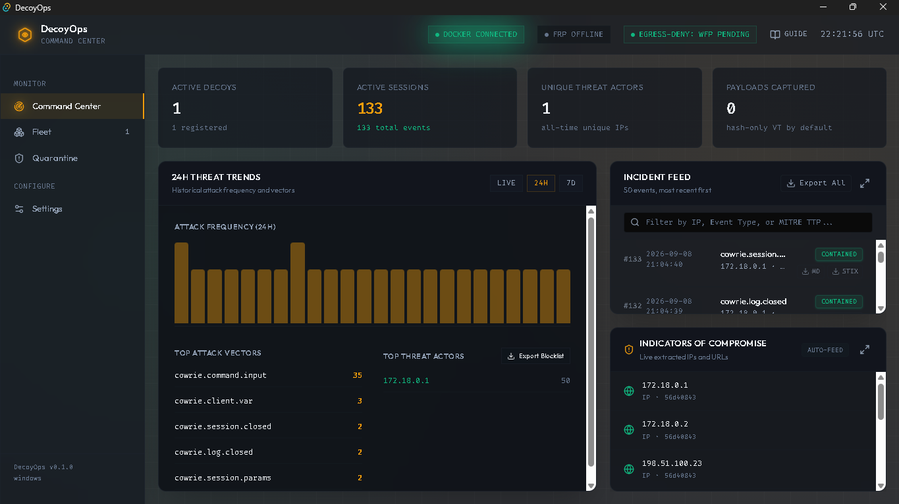
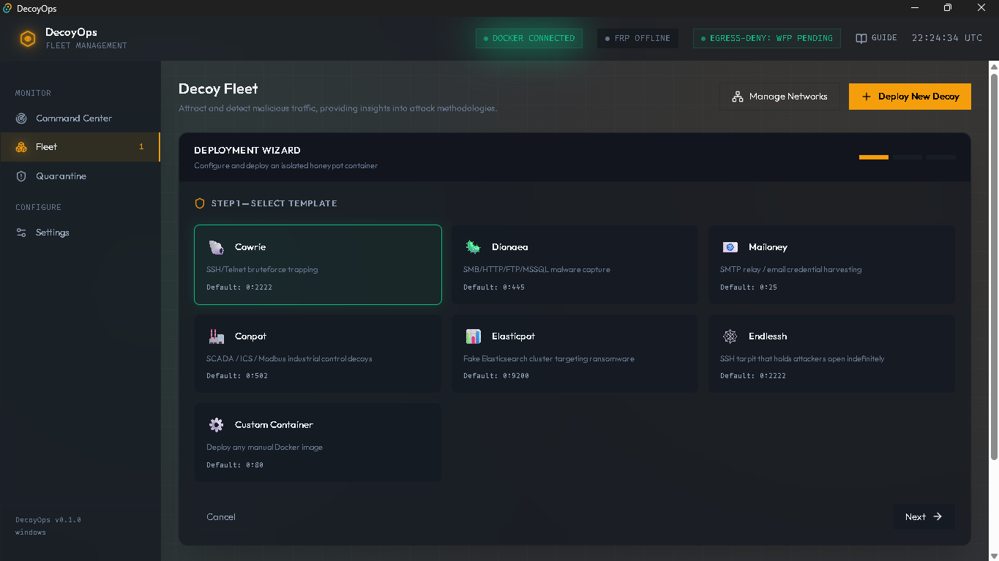

<p align="center">
  
</p>

<h1 align="center">DecoyOps</h1>

<p align="center">
  <a href="https://github.com/MR-05-001/decoyops/releases/latest"></a>
  <a href="https://github.com/MR-05-001/decoyops/actions"></a>
  <a href="https://opensource.org/licenses/MIT"></a>
  <a href="https://tauri.app/"></a>
</p>

> **DecoyOps** is a zero-trust, air-gapped desktop application for deploying, managing, and monitoring Docker-based network honeypots. Built on a Tauri 2.0 (Rust) backend and a React (TypeScript) frontend, it gives a single operator a real-time command center for observing attacker behavior safely, without exposing the host or requiring any paid infrastructure.

This project is actively maintained. See [§8 Project Status & Known Limitations](#8-project-status--known-limitations) before relying on any platform-specific behavior below.

---

## Screenshots

**Command Center** — live incident feed, Threat Map / 24h & 7d trends, Session Replay (Cowrie UML TTY decoder), and auto-extracted indicators of compromise:



**Deployment Wizard** — guided deploy across six honeypot templates, plus custom containers:



> Screenshots show test/lab traffic (local Docker bridge and RFC 5737 test-range IPs), not live internet exposure. Tunnel URLs and container IDs are redacted before publishing, since even ephemeral endpoints shouldn't be shared unnecessarily.

---

## 1. Architecture Stack

| Layer | Technology | Purpose |
| :--- | :--- | :--- |
| **Frontend** | React, TypeScript, TailwindCSS, Deck.gl (`maplibre-gl`) | UI rendering, live geospatial threat map, session replay, forensic hex viewer |
| **Backend Core** | Rust (Tauri 2.0) | Scoped IPC bridge, Docker orchestration (`docker.rs`), firewall/tunnel management |
| **Containerization** | Docker CE | Honeypot orchestration via `bollard`, encapsulated strictly behind `DockerProxy` in `docker.rs` (never exposed to the frontend or containers) |
| **Database** | SQLite | WAL mode, `busy_timeout = 5000`, single-writer task pattern with deduplicated event/file ingestion |
| **Telemetry** | `tokio` (async), `notify` (fs watching) | Event-driven + 60s Docker state reconciliation; watches JSON logs (`cowrie.json`, `dionaea.json`, `conpot.json`, `elasticpot.json`), plain-text/SMTP logs (`endlessh.log`, `commands.log`), and captured payloads |
| **Geolocation** | MaxMind GeoLite2 | Offline IP-to-location lookups |
| **Threat Intel** | AbuseIPDB, VirusTotal (free tiers) | Rate-limited (`governor` token bucket) + 24h cached reputation and hash-only file lookups |
| **Tunneling** | FRP (self-hosted) or ngrok | Selectable per deployment with env-injected tokens and 1 MB bandwidth limits; see [§3](#3-tunneling-frp-or-ngrok) |

---

## 2. Honeypot Templates

| Template | Default Image | Emulates & Telemetry |
| :--- | :--- | :--- |
| **Cowrie** | `cowrie/cowrie:latest` | SSH/Telnet bruteforce trapping (`cowrie.json`), UML binary TTY session replay (ANSI-stripped decoder), and downloaded/uploaded file quarantine |
| **Dionaea** | `dinotools/dionaea:latest` | Malware capture over SMB/HTTP/FTP/MSSQL with injected `log_json.yaml` (`dionaea.json`) and binary quarantine |
| **Mailoney** | `ghcr.io/telekom-security/mailoney:24.04.1` | SMTP relay credential harvesting (`commands.log`) |
| **Conpot** | `ghcr.io/telekom-security/conpot:24.04.1` | SCADA / ICS / Modbus industrial control decoys (`conpot.json`) |
| **Elasticpot** | `ghcr.io/telekom-security/elasticpot:24.04.1` | Fake Elasticsearch cluster targeting automated scans/exploits (`elasticpot.json`) |
| **Endlessh** | `ghcr.io/telekom-security/endlessh:24.04.1` | SSH tarpit holding attackers open indefinitely (`endlessh.log`) |
| **Custom Container** | User-specified image | Any Docker image deployed under DecoyOps network isolation and `cap-drop ALL` defaults |

---

## 3. Tunneling: FRP or ngrok

Each deployment can optionally expose a public ingress via either tunnel provider configured in Settings:

- **FRP (self-hosted)** — you run `frps` on your own VPS or server so traffic stays on infrastructure you control. Requires an always-on host; auth tokens are stored in the OS keyring and passed via `DECOYOPS_FRP_TOKEN` environment variable rather than written in plaintext to `frpc.toml`.
- **ngrok** — issues a temporary public TCP endpoint automatically without managing a VPS. Simpler for local testing; traffic traverses ngrok's infrastructure and free-tier URLs are **not stable across restarts**.

---

## 4. Security Hardening Constraints

Enforced in the codebase per [AGENTS.md](AGENTS.md):

1. **No direct Docker socket exposure.** Only `docker.rs` imports `bollard` (ADR-001); the webview can only invoke explicit named Tauri commands and containers never mount `/var/run/docker.sock`.
2. **Captures are never executed.** Payloads captured into host binary bind mounts are atomically moved into quarantine (`create_new(true)`) with a `.isolated` suffix and stripped permissions (`chmod 000` on Unix; read-only on Windows). VirusTotal submissions are hash-only (SHA-256) by default.
3. **Egress-deny by default, per decoy.** Managed decoys deploy onto dedicated bridge networks with `enable_ip_masquerade: false`, `enable_icc: false`, container default-route stripping, and host firewall subnet drop rules (`nftables` `inet decoyops` on Linux; PowerShell `NetFirewallRule` stopgap on Windows). Terminating one decoy on a shared network keeps the subnet drop rule intact while sibling containers remain attached.
4. **Scoped Tauri IPC surface.** No `shell:allow-execute`; filesystem permissions in [main.json](src-tauri/capabilities/main.json) are explicitly scoped and report exports sanitize CSV formulas and Markdown cells.
5. **Rate-limited, cached third-party lookups.** AbuseIPDB and VirusTotal calls validate IPs/digests strictly, reject unroutable IPs locally, and go through `governor` rate limiters + 24h SQLite/LRU caching.
6. **Capability-dropped containers.** Decoys run with `cap-drop: ALL` and `pids_limit: 256`; minimal capabilities (`NET_BIND_SERVICE`, and Dionaea init caps) and `no-new-privileges` exceptions (non-root `setcap` images Mailoney/Conpot) are applied only where required.
7. **Secrets stay in OS keyring.** API keys and tunnel auth tokens are stored via the `keyring` crate (Credential Manager / Keychain / Secret Service), never hardcoded or persisted in plaintext config/DB/logs.
8. **No auto-restart on abnormal exit by default.** Disabled unless explicitly enabled per decoy.

---

## 5. Installation & Setup

### Pre-built Installers
Download the latest release installer for **Windows** (`.msi` / `.exe`), **macOS** (`.dmg`), or **Linux** (`.AppImage` / `.deb`) from [GitHub Releases](https://github.com/MR-05-001/decoyops/releases/latest).

### Build Prerequisites
* **Node.js** (v20 or newer)
* **Rust** (Stable toolchain via `rustup`)
* **Docker CE / Docker Desktop**, running and accessible to your user context

**Linux only** — additional WebKit/Tauri system libraries:
```bash
sudo apt update
sudo apt install libwebkit2gtk-4.1-dev build-essential curl wget file libxdo-dev libssl-dev libayatana-appindicator3-dev librsvg2-dev
```

### Build & Test Commands

```bash
git clone https://github.com/MR-05-001/decoyops.git
cd decoyops
npm install

# Run development app
npm run tauri dev

# Verify Rust formatting, clippy lints, unit tests, and frontend bundle
cargo fmt --manifest-path src-tauri/Cargo.toml -- --check
cargo clippy --manifest-path src-tauri/Cargo.toml --all-targets -- -D warnings
cargo test --lib --manifest-path src-tauri/Cargo.toml
npm run build

# Build production installer -> src-tauri/target/release/bundle/
npm run tauri build
```

---

## 6. Automated CI/CD

[release.yml](.github/workflows/release.yml) builds and publishes Windows, macOS, and Linux installers via `tauri-apps/tauri-action` whenever a `v*` tag is pushed (or via manual `workflow_dispatch`).

---

## 7. Documentation

* [docs/blueprint-v2.md](docs/blueprint-v2.md) — core specification and data models
* [docs/blueprint-v3-hardening.md](docs/blueprint-v3-hardening.md) — firewall, tunneling, and capability-drop hardening details
* [docs/egress-fix-plan.md](docs/egress-fix-plan.md) — Linux `nftables` egress isolation design and verification notes
* [AGENTS.md](AGENTS.md) — standing constraints, ADRs, and coding standards for contributors and agents

---

## 8. Project Status & Known Limitations

- **Windows egress-deny (ADR-002):** Uses a PowerShell `NetFirewallRule` stopgap rather than a native Windows Filtering Platform (WFP) driver. Without Windows Administrator privileges, host `NetFirewallRule` creation is skipped and isolation relies on Docker's `enable_ip_masquerade: false`, `enable_icc: false`, and container default-route removal.
- **macOS firewall backend:** Managed-network firewall enforcement fails closed with `UnsupportedFirewallBackend` (`NotImplementedOs("macos")`) until a `pfctl` backend is added; use externally segmented unmanaged networks on macOS.
- **In-process Docker access (ADR-001):** `DockerProxy` connects directly to the Docker daemon inside the desktop process rather than via an out-of-process `docker-socket-proxy` sidecar. This prevents webview/IPC bypasses; a separate socket proxy remains the planned v2+ upgrade path.
- **Unix `chmod 000` quarantine inspection:** Because `.isolated` payloads have `0o000` mode on Linux/macOS, reading hex previews in the UI as a non-root user fails with `Permission denied` unless inspected with elevated privileges.
- **ngrok URL churn:** Free-tier ngrok endpoints rotate across restarts by design.

---

## 9. Responsible Use

DecoyOps deploys intentionally vulnerable services and can expose them to untrusted networks. When operating it:

- Only deploy decoys on infrastructure and network ranges you own or are explicitly authorized to monitor.
- Comply with applicable laws regarding honeypot operation and captured malware handling.
- Never execute or open captured payloads outside DecoyOps' read-only quarantine inspector.
- If you enable "C2 observation mode" (`allow_egress_ports` for a specific container IP), understand you are explicitly permitting limited outbound TCP connections from that decoy.

---

## 10. License

MIT License, with an additional security-research use notice. See [LICENSE](LICENSE) for full terms.
